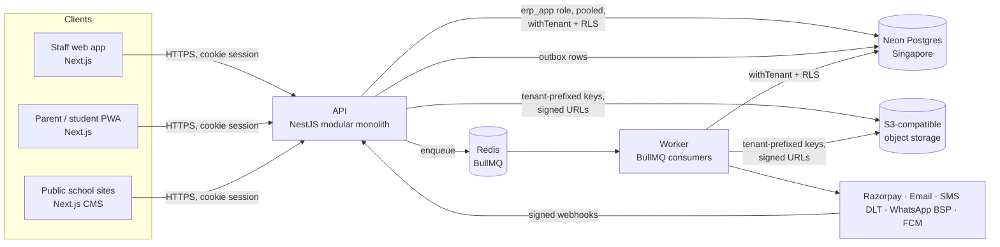

# System Design

Status: Phase 1 · Last updated: 2026-11-11

## 1. Shape of the system

A **modular monolith**: one API process, one worker process and one web app, sharing one
Postgres database (Neon). Domains are separated by module boundaries in code, not by network
calls. Microservices are out of scope until a measured need appears (ADR-004).



## 2. Repository layout

```
school-erp/
├── apps/
│   ├── api/        NestJS REST API (/api/v1, OpenAPI at /api/docs outside production)
│   ├── worker/     BullMQ consumers; every job runs inside withTenant
│   └── web/        Next.js App Router (staff app, portals, public sites)
├── packages/
│   ├── db/         Drizzle schema, migrations, withTenant, RLS checker, test utilities
│   ├── shared/     Money, ids (UUIDv7), errors, tenant-scoped key helpers
│   └── validation/ Zod schemas shared by API, worker and web (env, pagination, DTOs)
├── infrastructure/ Dockerfiles, local Postgres init (Neon-like roles)
├── docs/           Research, PRD, architecture, database, security, ADRs
└── .github/        CI
```

`packages/ui` (shadcn/ui components) and `packages/types` arrive in Phase 2 when the first
screens are built; empty packages are not created ahead of need.

## 3. Backend module anatomy (from Phase 2)

Each domain module (e.g. `students`) follows the same layout:

```
students/
├── students.controller.ts    HTTP only: parse DTO, call service, map response
├── students.service.ts       Use cases; opens withTenant; calls domain + repository
├── domain/                   Pure business rules (no I/O) — unit tested
├── students.repository.ts    Drizzle queries; receives a Transaction, never a pool
├── dto/                      Zod schemas from @school-erp/validation
├── students.permissions.ts   Permission strings + scope rules
└── *.test.ts
```

Rules: controllers never touch the database; repositories never open transactions;
business rules never import Nest or Drizzle.

## 4. Request lifecycle (Phase 2 target)

1. `RequestIdMiddleware` assigns `X-Request-Id`.
2. `SessionGuard` loads the session from the HttpOnly cookie → user.
3. `TenantGuard` resolves the tenant from the subdomain, verifies an active membership,
   and builds a `TenantContext` (tenantId, userId, campusIds, requestId).
4. `PermissionGuard` checks `@RequirePermission('students.view')` and scope.
5. Service runs `withTenant(db, ctx, tx => …)`; RLS limits rows to the tenant.
6. Audit interceptor writes an audit row in the same transaction.
7. `AllExceptionsFilter` returns errors in one envelope.

## 5. Asynchronous work

- Domain events are written to an `outbox_events` table in the same transaction as the change
  (Phase 2). A relay moves them to BullMQ; jobs are idempotent.
- Job data always uses the tenant envelope `{ tenantId, userId, requestId, payload }`, built
  from a verified context and re-validated by the worker (`runTenantJob`).
- Retries with exponential backoff; failed jobs stay in a dead-letter set for review.

## 6. Environments

| Env        | Database                                                  | Notes                                |
| ---------- | --------------------------------------------------------- | ------------------------------------ |
| Local      | Neon `dev` branch (or docker-compose Postgres offline)    | `.env` per developer                 |
| CI         | Postgres service; Neon branch per PR when secrets are set | Isolation suite on both              |
| Staging    | Neon `staging` branch                                     | Synthetic data only                  |
| Production | Neon `main` branch                                        | Paid plan before pilot; PITR enabled |

## 7. Capacity assumptions

Design point for year 2: 500 schools, ~750k students, ~30k concurrent users at the 8–10 am
attendance peak. One Neon compute with autoscaling and the pooler handles this comfortably for
OLTP; heavy reports move to a read replica or worker-built summary tables (Phase 13).
