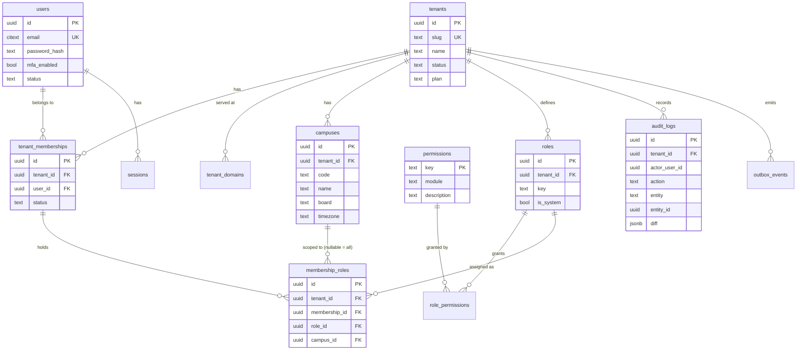
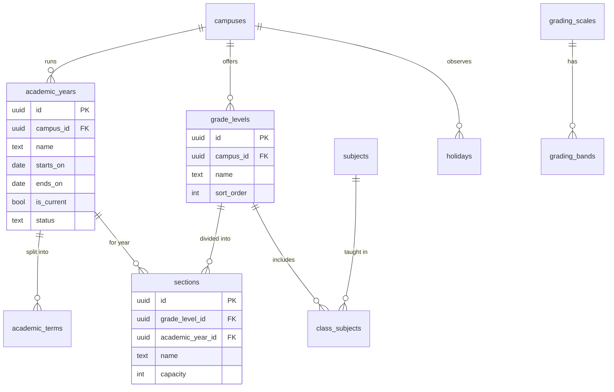
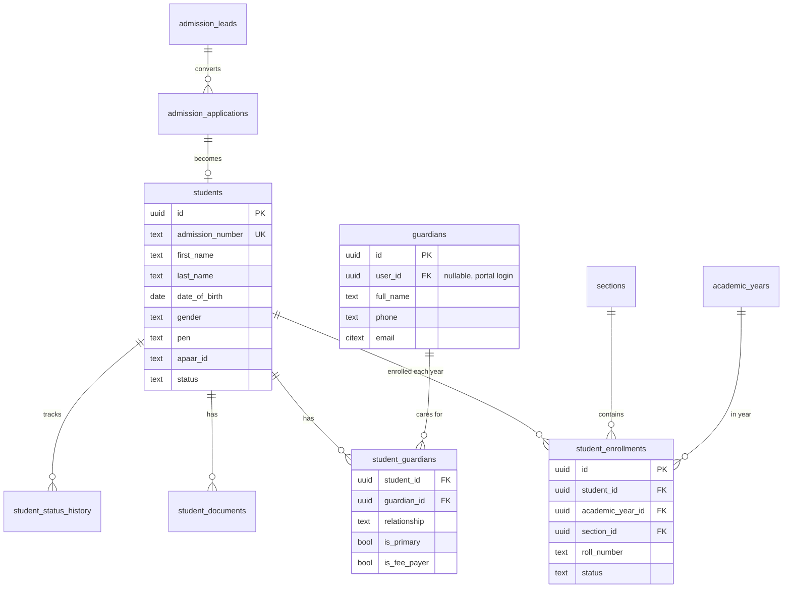
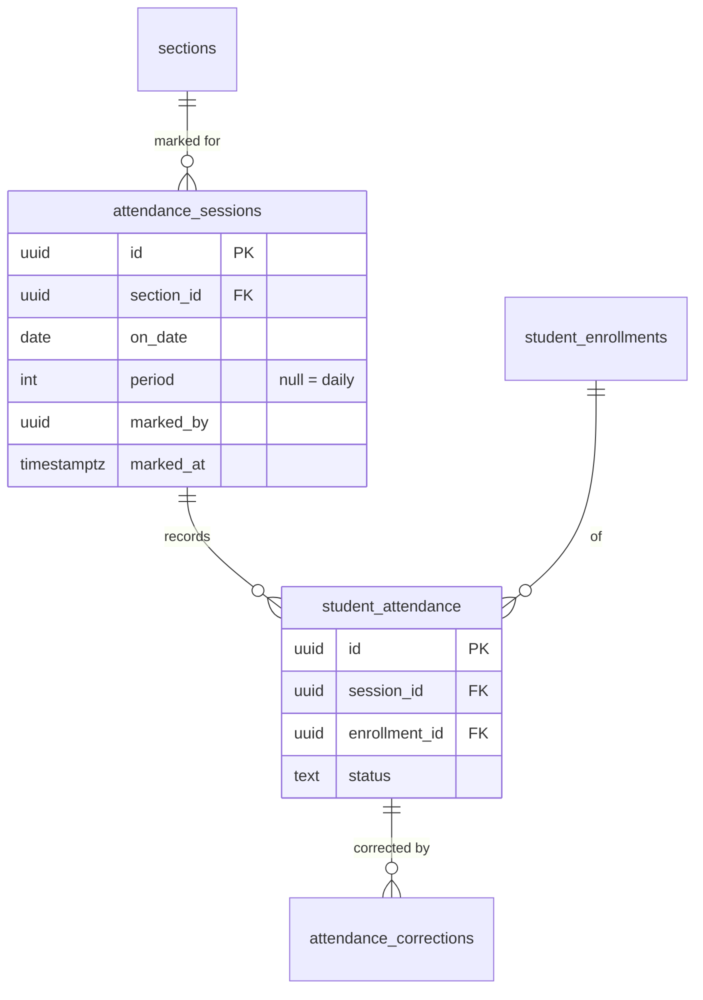
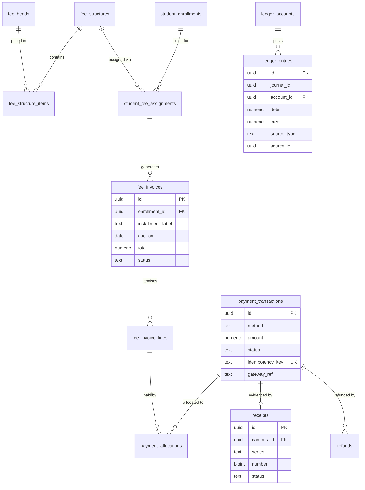

# Entity Relationship Diagram (initial)

Status: Phase 1 design. Tables are created phase by phase; Phase 2 builds the platform group.
Every tenant table also has `tenant_id`, `created_at`, `updated_at` and `unique (tenant_id, id)`;
they are omitted below for readability. All FKs between tenant tables are composite
`(tenant_id, x_id)`.

## Platform and tenancy (Phase 2)

## School structure (Phase 3)

## Students and admissions (Phase 4)

## Attendance (Phase 5)

## Fees and ledger (Phase 6)

Ledger rule: every journal's debits equal credits (deferred constraint trigger); entries are
append-only (no UPDATE/DELETE grants); corrections are reversing journals.
